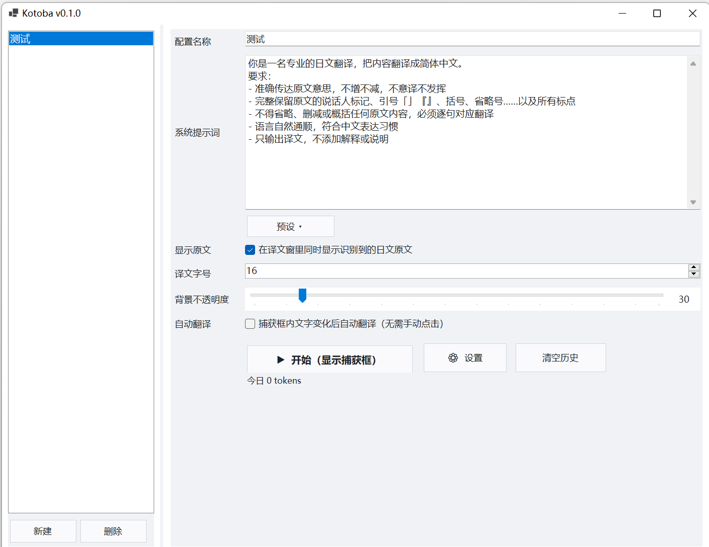
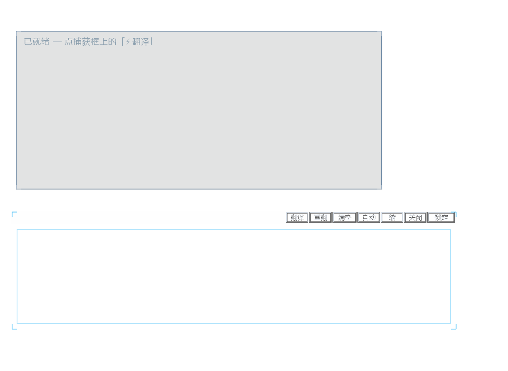
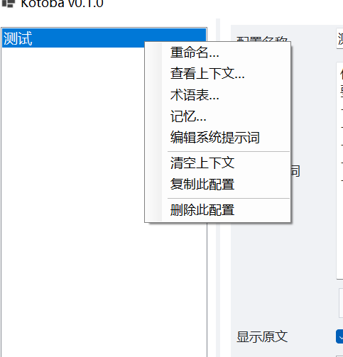
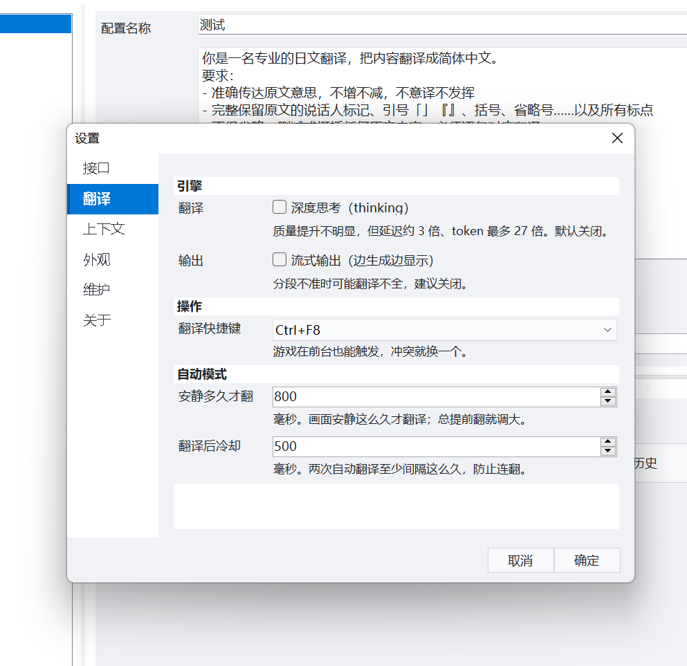
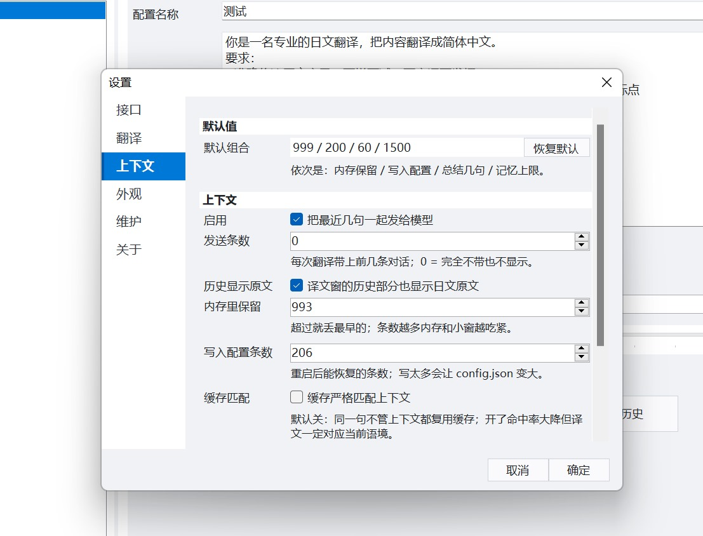
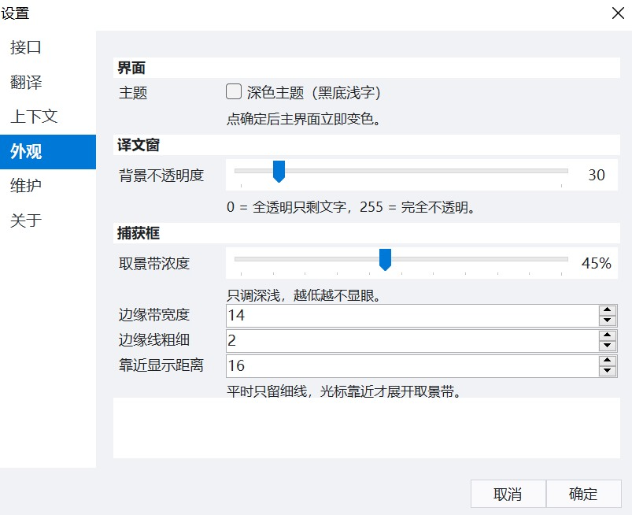
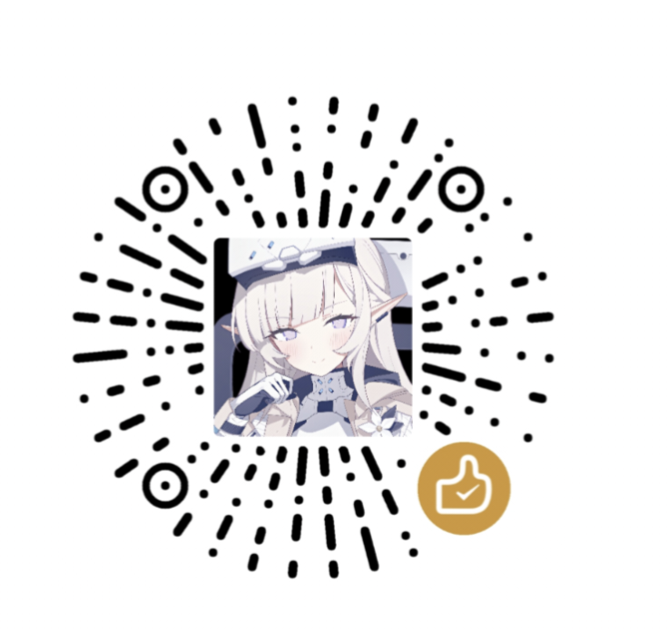

# Kotoba

> Windows 悬浮窗日文游戏翻译器 —— 框住对话框，按一下，中文就出来。

不修改游戏文件、不注入进程、不限引擎，靠「截图 → 大模型 OCR → 翻译」工作。
适用于有日文字幕的 PC 游戏。

## 功能

- **悬浮捕获框**：拖到对话框上即可，四角可拖拽调大小；鼠标靠近才显示取景带，平时不挡画面
- **大模型翻译**：DeepSeek Vision 识图 + 大模型翻译，术语表、上下文、长期记忆三层约束
- **语义分段**：先把整屏文字切成句子再逐句翻译，避免一句话被拆成两半
- **自动模式**：画面安静后自动翻译，不用每句都按一遍
- **翻译缓存**：同一画面重复出现直接复用，约 1 秒出结果
- **多配置**：每个游戏一套（识别区域、模型、术语表、记忆、提示词），可复制
- **缩成小球**：不想看浮窗时收成一个小圆球，点一下还原，会话不中断
- **零侵入**：关掉工具对游戏没有任何影响

## 快速开始

1. **下载**：到 [Releases](../../releases) 下载 `Kotoba-v0.1.0-win-x64.zip`，解压到任意目录（已自带 .NET 运行时，无需安装任何东西）
2. **填 Key**：打开设置 → 接口，填入 DeepSeek API Key
3. **翻译**：点「开始」→ 把捕获框拖到游戏对话框上 → 点「翻译」

## 界面说明

<b>主页面</b>

支持多个配置，不同游戏用不同配置。

每个配置都可以写自己的系统提示词——提示词对翻译结果影响很大。目前内置了几条常用提示词，在提示词框下方的「预设」里选择。

<b>翻译输出框 & 识别框</b>

两个窗口都能自由调整位置、大小和不透明度。

- **识别框**（下方）：框住要识别的区域，鼠标可以穿透点到游戏
- **翻译输出框**（上方）：显示译文，不能穿透

识别框上的按钮：

| 按钮 | 作用 |
|---|---|
| 翻译 | 翻译当前区域 |
| 重翻 | 忽略缓存重新翻译 |
| 清空 | 清空上下文 |
| 自动 | 自动翻译 |
| 缩 | 缩成一个小圆球，再点展开 |
| 关闭 | 关闭悬浮窗，可在系统托盘重新打开 |
| 锁定 | 位置与大小不再改变 |

<b>配置子菜单（右键配置）</b>

| 项 | 作用 |
|---|---|
| 重命名 | 修改该配置的名称 |
| 查看上下文 | 查看历史翻译，可导出 / 导入 |
| 术语表 | 指定「原文=译文」，模型遇到该词按指定译法翻译 |
| 记忆 | 把长期设定或剧情摘要一并发给模型，帮助理解；也可以手动编辑 |
| 编辑系统提示词 | 直接编辑该配置的提示词 |
| 清空上下文 / 复制此配置 / 删除此配置 | 字面意思 |

> 添加记忆会增加 token 消耗——每一句翻译都会把记忆一起发出去。

<b>设置界面</b>

**接口**：填入自己的 API Key 与接口地址。目前仅针对 DeepSeek 测试过；理论上是 OpenAI 兼容接口，换成别家可能能用，但可能出现未知问题。

模型分两种：

| 用途 | 可选 |
|---|---|
| 识别模型 | `deepseek-flash`（V4.1-Flash，支持图片） |
| 翻译模型 | `deepseek-flash` 或 `deepseek-v4-pro`（V4-Pro） |

**翻译**

- **深度思考**：质量提升不明显，时间和 token 消耗明显增加，默认关闭
- **流式输出**：不建议开启，分段不准时会出现翻译不全
- **翻译快捷键**：可自定义；若无效通常是与其他软件冲突，换一个即可
- **自动模式**：安静多久才翻 / 翻译后冷却。出现「话没说完就翻译」把前者调大，出现「换句了没翻译」把后者调小

**上下文**

- 建议启用。会把最近几句对话一并发给模型，有助于提升译文质量，条数建议 3~5
- **内存里保留**：本次运行期间最多记住多少条，超过就丢最早的
- **写入配置条数**：关程序前把最近多少条写进 `config.json`，重启后能恢复
- **缓存严格匹配上下文**：开启后命中率大幅下降，几乎每次都要真实调用，换来的是译文贴合当前语境。实测差别有限，遇到个别语句不对劲时，直接用识别框上的「重翻」更划算

**外观**

主题（深色/浅色）、译文窗背景不透明度、捕获框的取景带浓度、边缘带宽度、边缘线粗细、靠近显示距离。

**维护**：清空翻译缓存、查看当日 token 用量、重置窗口位置。

**关于**：版本信息、项目主页、可折叠的功能帮助。

## 费用

翻译走你自己的 DeepSeek API Key，按量计费，本工具不收取任何费用。

- 重复画面命中缓存时只花 OCR 的钱
- 想更省：日常用 `deepseek-flash`、上下文条数保持 2~3、记忆定期清理

## 常见问题

**无法访问 API？** 检查网络 / 代理、Key 是否有效、账户余额。

**Ctrl+F8 没反应？** 安全软件可能拦截全局热键（把文件夹加白名单）；独占全屏游戏也可能吞掉热键，可改无边框窗口模式。

**译文窗被别的窗口挡住？** 点一下捕获框或重新开始会话即可回到最上层。

**识别不准？** 捕获框要刚好框住文字区域；框太大 OCR 慢，也容易读到多余文字。

**换电脑配置没了？** 配置保存在 `%APPDATA%\Kotoba\`，不随程序目录迁移，需要重新填 Key。

## 已知限制

- 仅支持日文 → 简体中文
- 仅针对 DeepSeek API 测试过
- 仅支持 64 位 Windows
- 多显示器 / 不同缩放率未充分测试
- 独占全屏可能拦截全局热键

## 支持作者

如果觉得这个工具对你有帮助，可以支持一下作者

打赏完全自愿，不影响任何功能，也不代表购买服务。

## 免责声明

本工具仅用于辅助阅读：截取屏幕、调用第三方 API 完成翻译，不修改、不破解、不传播任何游戏文件或内容。使用产生的 API 费用由使用者自行承担，并请遵守所玩游戏的服务条款与当地法律法规。

## 许可证

[MIT](LICENSE)